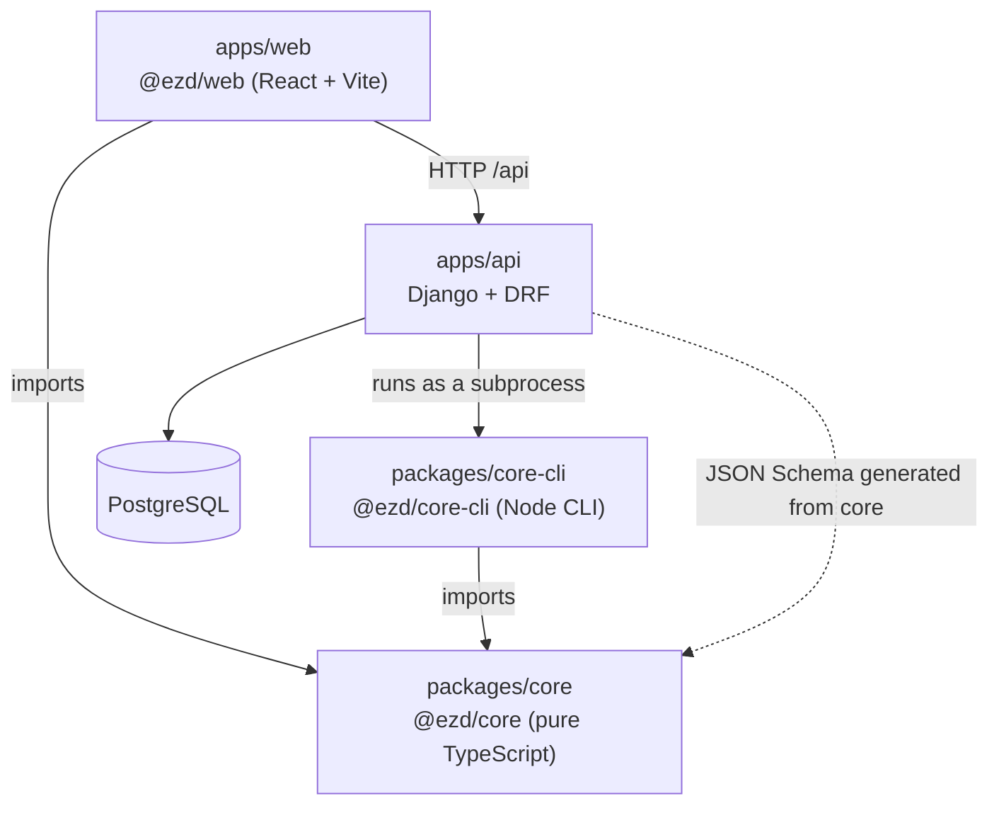
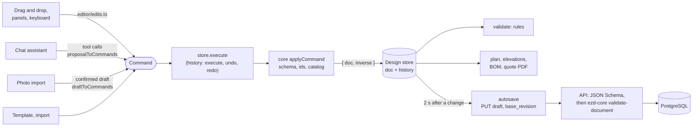
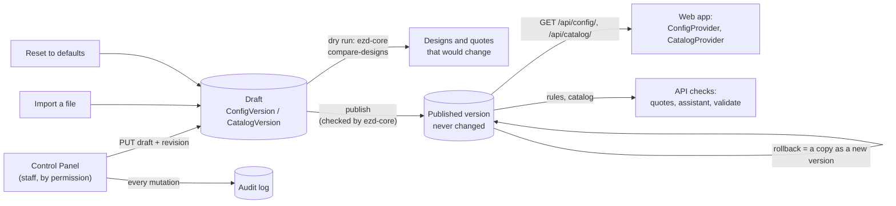

# Architecture

EZDesign has one source of truth, the **Design Document** (typed, versioned JSON), and one
way to change it, the **command layer**. Both live in `@ezd/core`. Everything else is a
client.

## Dependency direction

- `web` and `core-cli` depend on `core`. `core` depends on nothing in this repository and
  never imports from them.
- `api` is Python and cannot import `core`. It reaches the same rules in two ways:
  - **JSON Schema** generated from core's schemas, for structural validation of documents
    and commands.
  - **`core-cli`**, run as a subprocess, for anything that needs core's logic (`validate`,
    `apply`). The CLI is bundled into a single file, so the API image needs only Node and
    that file.
- `web` talks to `api` over HTTP only. In development the Vite server proxies `/api` to
  `http://localhost:8000`.

## What keeps `core` pure

`core` must run unchanged in the browser, in the CLI and in tests, so it has no React,
Three.js, Konva, DOM or Node-only APIs. Two checks enforce that in CI:

| Check                                 | Where                            |
| ------------------------------------- | -------------------------------- |
| ESLint `no-restricted-imports`        | `packages/core/eslint.config.js` |
| `"lib": ["ES2023"]` and `"types": []` | `packages/core/tsconfig.json`    |

The first rejects the imports by name. The second removes DOM and Node globals
(`document`, `window`, `process`, `Buffer`) from the type environment, so using them does
not compile.

## How consumers resolve `@ezd/core`

`packages/core/package.json` exports its TypeScript entry under a custom `@ezd/source`
condition, ahead of the compiled `dist` output. `tsconfig.base.json`, the Vite and Vitest
configs and the `core-cli` esbuild command all enable that condition, so they read core's
source directly. A change in core shows up in web and CLI tests and in the web dev server
with no intermediate build. `pnpm build` still compiles `core` to `dist` for any consumer
that does not set the condition.

## How a change flows

Every client of the document makes a `Command` and hands it to core. Nothing else writes
to a document.

- **The editor** (`apps/web/src/store/designStore.ts`) is the only place that replaces the
  document, with what core's `execute`, `undo` or `redo` returned. ESLint rejects any other
  assignment.
- **The chat assistant** never changes the document: its tool calls become one `batch`,
  dry-run in the browser and drawn as ghosts; Accept executes the batch as one command.
- **Photo import** is the same shape one step earlier: the model's answer becomes a draft,
  the user corrects it, and the confirmed draft becomes one `batch` applied to an empty
  document, which the server stores as the design and its version 1.
- **The server** never trusts the browser: every stored document passes the JSON Schema
  generated from core and then core itself (`ezd-core validate-document`), and a confirmed
  photo draft is checked again with `ezd-core draft-problems`.

## How configuration flows

The Control Panel edits configuration, never a design. A configuration is versioned data:
drafts are editable, published rows never change, and every setting has a compiled-in
default, so the editor at `/` works with no API.

- **One version number names a configuration.** The app settings, rules and quote defaults
  are sections of one `ConfigVersion`, each edited with its own permission and published
  together. The catalog is its own series (`CatalogVersion`), because a quote names the
  catalog version it was priced with.
- **Schemas live in core**, validation runs through `ezd-core`, storage and HTTP live in
  `apps/api/controlpanel/`, and the screens in `apps/web/src/admin/`.
- **Concurrency** is a revision on each draft: a stale save is a 409 that names who saved
  last (`conflict` in the body), and `ConflictNotice` shows it.
- **History** compares any two published versions section by section (`controlpanel/diff.py`,
  lists of objects with an `id` are matched by id), and every version records who published it
  and a note. The audit log holds the before and after of every mutation.
- **Roles** are Django groups holding the Control Panel's permission codes
  (`controlpanel/codes.py`); the seeded three cannot be changed.

## What is where

| Concern                                                                     | Code                                                                                             |
| --------------------------------------------------------------------------- | ------------------------------------------------------------------------------------------------ |
| Document, commands, history, rules, snapping, BOM and pricing, scene        | `packages/core/src/`                                                                             |
| Chat: summary for the model, tools, proposal to commands                    | `packages/core/src/llm/`, `apps/api/chat/`, `apps/api/llm/`                                      |
| Photo: draft schemas, normalising, problems, draft to commands              | `packages/core/src/photo/`, `apps/api/photos/`                                                   |
| Editor: store, views, tools, panels                                         | `apps/web/src/store/`, `apps/web/src/editor/`                                                    |
| Accounts, projects, designs, versions, autosave                             | `apps/api/accounts/`, `apps/api/projects/`, `apps/web/src/lib/`                                  |
| Quotes and their PDF                                                        | `apps/api/quotes/`, `apps/web/src/quotes/`                                                       |
| Control Panel: config and catalog versions, audit, roles, import and export | `apps/api/controlpanel/`, `apps/web/src/admin/`, `packages/core/src/config/`                     |
| Errors: boundary, reporting hooks, readiness                                | `apps/web/src/ErrorBoundary.tsx`, `apps/web/src/lib/reportError.ts`, `apps/api/config/errors.py` |

See also `docs/EXTENDING.md` (what v1 left out and how to add it), `docs/OPERATIONS.md`,
`docs/SECURITY.md`, `docs/PERFORMANCE.md`, `docs/BROWSERS.md` and `docs/RULES.md`.

## Rules that shape later phases

- All mutations go through commands. Drag and drop, LLM tool calls, undo and redo, server
  validation and import use the same commands.
- The LLM never produces geometry. It proposes commands; core validates and applies them.
- Lengths are integer sixteenths of an inch (`Len`). Money is integer cents. Angles are
  integer degrees. Text formatting happens only at the UI boundary.
