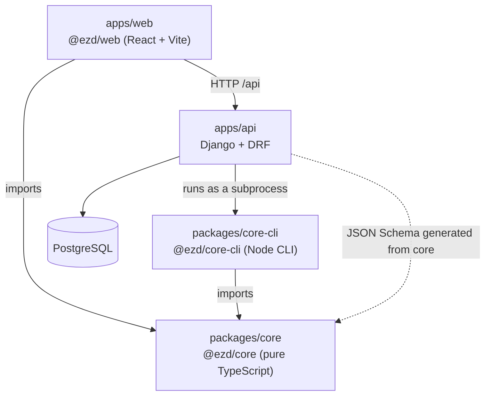

# Architecture

EZDesign has one source of truth, the **Design Document** (typed, versioned JSON), and one
way to change it, the **command layer**. Both live in `@ezd/core`. Everything else is a
client.

## Dependency direction

- `web` and `core-cli` depend on `core`. `core` depends on nothing in this repository and
  never imports from them.
- `api` is Python and cannot import `core`. It reaches the same rules in two ways:
  - **JSON Schema** generated from core's schemas, for structural validation of documents
    and commands.
  - **`core-cli`**, run as a subprocess, for anything that needs core's logic (`validate`,
    `apply`). The CLI is bundled into a single file, so the API image needs only Node and
    that file.
- `web` talks to `api` over HTTP only. In development the Vite server proxies `/api` to
  `http://localhost:8000`.

## What keeps `core` pure

`core` must run unchanged in the browser, in the CLI and in tests, so it has no React,
Three.js, Konva, DOM or Node-only APIs. Two checks enforce that in CI:

| Check                                 | Where                            |
| ------------------------------------- | -------------------------------- |
| ESLint `no-restricted-imports`        | `packages/core/eslint.config.js` |
| `"lib": ["ES2023"]` and `"types": []` | `packages/core/tsconfig.json`    |

The first rejects the imports by name. The second removes DOM and Node globals
(`document`, `window`, `process`, `Buffer`) from the type environment, so using them does
not compile.

## How consumers resolve `@ezd/core`

`packages/core/package.json` exports its TypeScript entry under a custom `@ezd/source`
condition, ahead of the compiled `dist` output. `tsconfig.base.json`, the Vite and Vitest
configs and the `core-cli` esbuild command all enable that condition, so they read core's
source directly. A change in core shows up in web and CLI tests and in the web dev server
with no intermediate build. `pnpm build` still compiles `core` to `dist` for any consumer
that does not set the condition.

## Rules that shape later phases

- All mutations go through commands. Drag and drop, LLM tool calls, undo and redo, server
  validation and import use the same commands.
- The LLM never produces geometry. It proposes commands; core validates and applies them.
- Lengths are integer sixteenths of an inch (`Len`). Money is integer cents. Angles are
  integer degrees. Text formatting happens only at the UI boundary.
